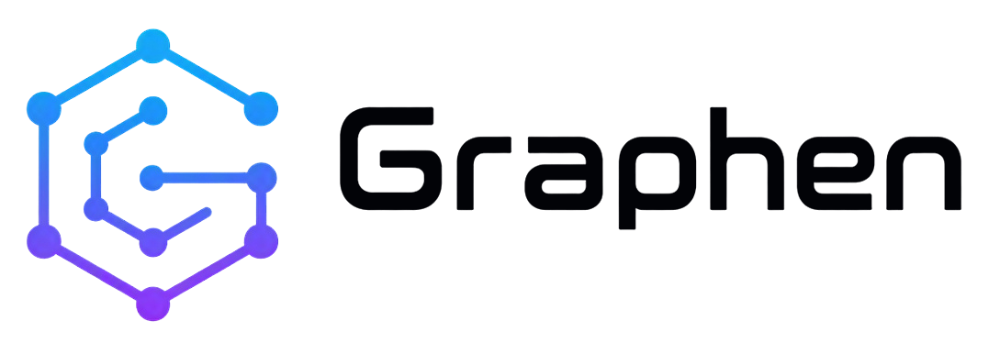

<p align="center">
  <picture>
    <source media="(prefers-color-scheme: dark)" srcset="frontend/public/logo-text-dark.png">
    <source media="(prefers-color-scheme: light)" srcset="frontend/public/logo-text-light.png">
    
  </picture>
</p>

<p align="center">
  <em>Tracing and observability for coding agents.</em>
</p>

<p align="center">
  <a href="https://github.com/graphen-studio/graphen-trace/blob/main/LICENSE"></a>
  <a href="https://www.python.org/"></a>
  <a href="https://fastapi.tiangolo.com/"></a>
  <a href="https://www.sqlite.org/"></a>
</p>

## Overview

**Graphen Trace** captures and explores coding-agent activity across sessions, messages, model usage, tool execution, and live events. It stores observations in a local SQLite database and provides a dashboard backed by the Graphen API.

The passive collectors read OpenCode's local SQLite database and, when available, observe its existing local service event stream. The Pi adapter reads local session JSONL files. Collection is read-only: Graphen Trace does not edit agent configuration or start agent processes.

## Features

- **Session and message timelines:** Browse captured sessions, complete native message records, tool executions, and parent/child session links.
- **Token and cost visibility:** Inspect native usage categories and agent-reported cost, with missing or partial data clearly identified.
- **Live event observation:** Persist events from an already-running local OpenCode service and expose connection health and possible gaps.
- **Local dashboard and API:** Explore synchronized data through the web dashboard and documented HTTP endpoints.
- **Read-only collection:** Read OpenCode SQLite and Pi session files without changing agent configuration or source records.
- **Local-first storage:** Keep captured data in a Graphen SQLite database on your machine.
- **Compatibility reporting:** Surface warnings and partial collection status when source versions or individual records cannot be fully interpreted.

## Privacy and data handling

Captured records may include prompts, responses, exposed reasoning, tool arguments and results, errors, provider metadata, and attachment references. **No automatic redaction, truncation, or expiry is applied.** The local database may contain sensitive content, including secrets printed during an agent run. Attachment references do not cause external files or URLs to be fetched, and provider credentials are not captured. Review the collection details below before enabling it.

## Installation

### From source

Requirements: Python 3.11 or newer, [Poetry](https://python-poetry.org/), and Node.js/npm to build the dashboard frontend.

```bash
git clone https://github.com/graphen-studio/graphen-trace.git
cd graphen-trace
make install
make frontend-install
make frontend-build
```

The frontend build is included in the Python wheel and source distribution. Installed users do not need Node.js to run the dashboard.

## Usage

### Discover installed agents

Detect known local agent installations without starting collection or modifying them:

```bash
poetry run graphen-trace discover
```

### Start the dashboard and passive collection

```bash
poetry run graphen-trace serve
```

Open [http://127.0.0.1:8765/](http://127.0.0.1:8765/) in your browser. Press `Ctrl+C` to stop the service.

HTTP access logs are quiet by default to avoid flooding the terminal while the
dashboard polls the API. Set `GRAPHEN_TRACE_ACCESS_LOG=1` when debugging to
enable them.

### Run OpenCode through the optional local proxy

```bash
poetry run graphen-trace run opencode
```

Arguments after the command are passed to OpenCode. This mode starts the optional local proxy for that OpenCode process.

### CLI commands

| Command | Description |
| --- | --- |
| `graphen-trace about` | Display product and version information |
| `graphen-trace discover` | Detect installed coding agents without starting collection |
| `graphen-trace serve` | Start the dashboard, API, and passive collection |
| `graphen-trace run opencode [args...]` | Launch OpenCode through the optional local proxy |

## Development

```sh
make install
make frontend-install
make frontend-build
make cli ARGS="serve"
```

Open `http://127.0.0.1:8765/`. For UI development, run `make frontend-dev` in a
separate terminal; Vite forwards `/api` to the local backend.

## Checks and distribution

```sh
make lint
make test
make build
```

Install frontend dependencies explicitly before building. The build includes
`graphen_trace/web/dist` in the wheel and sdist; installed users do not need Node.


## License

This project is licensed under the MIT License. See the [LICENSE](LICENSE) file for details.
